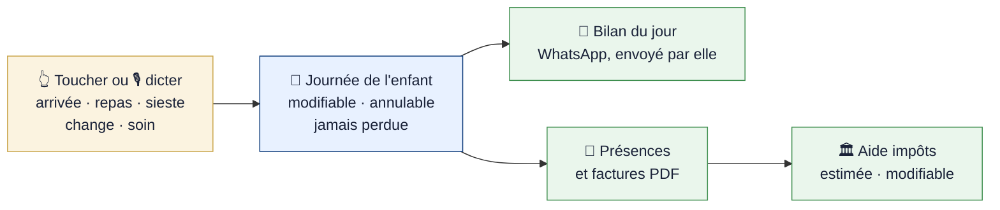
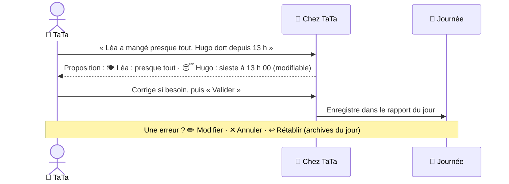
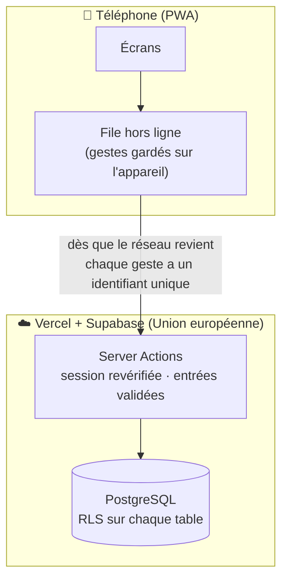
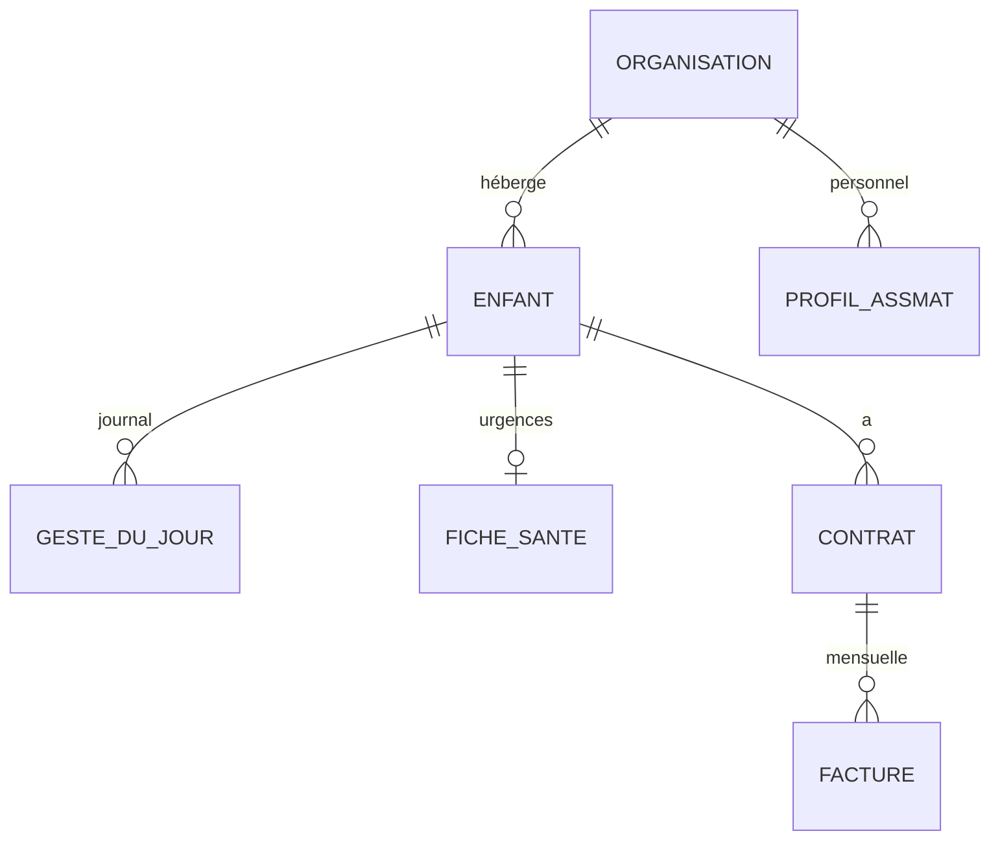

# 🧸 Chez TaTa

**Moins d'administratif, plus de temps pour les enfants.**
L'outil de poche des assistantes maternelles : on pointe la journée en quelques gestes (ou à la voix), et le reste — bilan aux parents, présences, factures, aide pour les impôts — se prépare tout seul.

🌐 En ligne : <https://chez-tata.vercel.app> · 🎬 Démonstration ouverte à tous (animée, avec une musique douce que l'on peut couper) : <https://chez-tata.vercel.app/demo>

---

## L'idée en 10 secondes

**Une seule saisie, zéro ressaisie.** Ce que l'assistante touche ou dicte pendant la journée alimente tout le reste.



## Dicter plutôt qu'écrire

Les mains occupées ? On parle, c'est proposé, on corrige si besoin, on valide. **Rien n'est enregistré sans « Valider ».**



> Sur iPhone, la dictée intégrée marche surtout dans **Safari** ; sinon, le micro du clavier fait la même chose.

## Ce qu'on trouve dans l'application

| Onglet | À quoi ça sert |
|---|---|
| **Aujourd'hui** | Une carte par enfant (👧 / 👦) : 6 gestes en un toucher, « Journée de … », bilan WhatsApp, message aux parents, fiche **Urgence** |
| **Planning** | Feuille de présence A4 prête à imprimer |
| **Gestion** | Enfants, familles, contrats PDF, factures « paiement reçu », charges |
| **Profil** | Identité, agrément, assurance, **aide à la déclaration d'impôts** (modifiable, jamais présentée comme officielle) |

Couleurs **et** emojis pour chaque geste (la couleur n'est jamais seule) : 👋 arrivée · 🏠 départ · 🍽️ repas · 😴 sieste · 🧷 change · 🩹 soin.

## Comment ça marche

Les gestes sont gardés sur le téléphone puis envoyés dès que le réseau le permet : **ça marche aussi sans connexion**, sans doublon.



**La sécurité repose sur la base de données** : chaque ligne porte un `organization_id`, et la RLS (Row Level Security) empêche de lire ou d'écrire les données d'un autre espace, même si le code web contenait une erreur.



Détails techniques : [`docs/ARCHITECTURE.md`](docs/ARCHITECTURE.md) · Sécurité et audit : [`docs/AUDIT.md`](docs/AUDIT.md) · Connexion Google : [`docs/GOOGLE_SIGNIN.md`](docs/GOOGLE_SIGNIN.md)

## Pile technique

Next.js 16 (App Router, Cache Components) · React 19 · TypeScript · Tailwind CSS 4 · Supabase (Auth, PostgreSQL, RLS) · Vercel · Vitest + PGlite (vrai PostgreSQL en mémoire pour tester l'isolation).

## Démarrer

```bash
npm install
cp .env.example .env.local   # renseigner les variables Supabase
npm run dev
```

Base de données : appliquer `supabase/migrations/` dans l'ordre (`supabase db push`).
Réglages Supabase Auth attendus : confirmation d'e-mail **activée**, mot de passe de 10 caractères minimum, protection contre les mots de passe compromis **activée** (réglage du tableau de bord), URL de redirection `<site>/auth/confirm`.

## Avant de livrer

```bash
npm run lint && npm run typecheck && npm test && npm run build
npm audit --omit=dev --audit-level=high
```

## Règles du projet

- 🔐 Aucun secret dans le dépôt ni dans le navigateur ; jamais de clé `service_role` côté web.
- 🧱 Toute nouvelle table : `organization_id`, RLS activée, privilèges explicites (rien pour `anon`), tests d'isolation.
- 💶 Montants en centimes. Une estimation n'est **jamais** présentée comme une paie ou un document officiel.
- 👶 Aucune information sur un enfant n'est inventée ni envoyée automatiquement (WhatsApp : toujours confirmé par l'utilisatrice).
- 🧪 Données de test fictives uniquement. Interface en français.

## Déploiement

Projet Vercel `chez-tata` (fonctions à Francfort, près de la base). Variables : `NEXT_PUBLIC_SUPABASE_URL`, `NEXT_PUBLIC_SUPABASE_PUBLISHABLE_KEY`, `NEXT_PUBLIC_SITE_URL`, et en **secrètes** `DEMO_ACCESS_CODE`, `DEMO_EMAIL`, `DEMO_PASSWORD`.
Déployer : `vercel deploy --prod`. Après un changement de domaine, mettre à jour `NEXT_PUBLIC_SITE_URL` et Supabase → Auth → URL Configuration.
